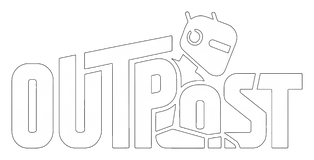

<div align="center">
  

  <h1>Outpost</h1>
  <p><strong>An AI-powered workspace where ideas become plans, diagrams, and documentation.</strong></p>
  <p>Chat with an agent that writes in your document and builds on your canvas, while your team collaborates in real time.</p>

  <p>
    <a href="#-screenshots">Screenshots</a> ·
    <a href="#-live-app--demo">Live app &amp; demo</a> ·
    <a href="#-getting-started">Get started</a> ·
    <a href="#-technology">Technology</a>
  </p>

  <p>
    
    
    
    
    
  </p>
</div>

---

## ✨ About

Outpost brings an AI agent, a collaborative document, and an infinite canvas together in one workspace. Describe what you are planning, and the agent can turn the request into a written document, a visual diagram, or both.

Use it to sketch an architecture, map a workflow, design an ERD, draft a plan, or keep a team's thinking and documentation side by side.

## 🚀 Features

- **AI workspace agent** — powered by Google Gemini through the Vercel AI SDK, with streaming responses and tools that make changes directly to the workspace.
- **Document editor** — rich-text documents with Markdown-style content and live collaboration.
- **Infinite canvas** — create and edit shapes, text, arrows, and entity-relationship diagrams.
- **Canvas and document together** — work in either surface or ask the agent to keep both in sync.
- **Live collaboration** — collaborate on documents with Yjs and Supabase Realtime; share canvas updates with tldraw sync.
- **Public read-only links** — share a workspace with people outside your team.
- **PDF export** — export the document and canvas.
- **Voice input** — dictate prompts from the workspace.
- **Workspaces and teams** — organize work, manage workspace status, and collaborate in an organization.
- **Plans and usage controls** — plan entitlements, prompt allowances, and workspace limits are integrated with Clerk Billing.

## 🖼️ Screenshots

<div align="center">
  <h3>Landing page</h3>
  
</div>

<br />

<div align="center">
  <h3>Dashboard</h3>
  
</div>

<br />

<div align="center">
  <h3>AI agent working across a document and canvas</h3>
  
</div>

<details>
  <summary>More screenshots</summary>
  <br />
  <p align="center"><strong>Account creation</strong></p>
  <p align="center"></p>
  <p align="center"><strong>Plans and pricing</strong></p>
  <p align="center"></p>
</details>

## 🌐 Live app & demo

- **Live app:** outpost-seven-xi.vercel.app
- **Demo video:** Coming soon — add your YouTube, Loom, or other video link here.

> **When ready:** Replace the two lines above with links, for example `[Open Outpost](https://your-deployed-domain.com)` and `[Watch the demo](https://your-video-link)`.

## 🧰 Technology

| Area | Technologies |
| --- | --- |
| Application | Next.js 16 App Router, React 19, TypeScript |
| Styling and UI | Tailwind CSS 4, Radix UI, shadcn/ui components, Lucide React |
| AI | Vercel AI SDK, Google Gemini (`@ai-sdk/google`) |
| Canvas | tldraw, custom entity-table shapes, `@tldraw/sync` |
| Documents | BlockNote, Yjs, y-prosemirror |
| Real-time collaboration | Supabase Realtime, Yjs |
| Authentication and billing | Clerk |
| Database and ORM | PostgreSQL, Prisma 7, Prisma PostgreSQL adapter |
| PDF export | BlockNote PDF exporter, jsPDF |
| Other libraries | `@hello-pangea/dnd`, `date-fns`, `next-themes`, `sonner` |

## 🏁 Getting started

### Prerequisites

- Node.js compatible with the installed Next.js version
- npm
- A PostgreSQL database
- Clerk, Google AI, and Supabase projects configured for the services you want to use

### 1. Install

```bash
git clone https://github.com/PiyushKumar888/outpost.git
cd outpost
npm install
```

### 2. Configure environment variables

Create a `.env` file in the project root. Add your own values; **never commit this file or paste secrets into the README**.

```dotenv
# Database
DATABASE_URL=
DIRECT_URL=

# Clerk
NEXT_PUBLIC_CLERK_PUBLISHABLE_KEY=
CLERK_SECRET_KEY=

# Google Gemini
GOOGLE_GENERATIVE_AI_API_KEY=

# Supabase Realtime
NEXT_PUBLIC_SUPABASE_URL=
NEXT_PUBLIC_SUPABASE_PUBLISHABLE_KEY=

# Optional: configure a dedicated tldraw sync server and license
NEXT_PUBLIC_TLDRAW_SYNC_URL=
NEXT_PUBLIC_TLDRAW_LICENSE_KEY=
```

`DIRECT_URL` is optional if `DATABASE_URL` can also be used for Prisma migrations. Configure Clerk's sign-in/sign-up and billing plans in the Clerk dashboard. The document collaboration features require Supabase Realtime. For production, configure a dedicated tldraw sync server rather than relying on the development demo service.

### 3. Prepare the database

```bash
npx prisma generate
npx prisma migrate dev
```

### 4. Start the development server

```bash
npm run dev
```

Open [http://localhost:3000](http://localhost:3000).

## 📜 Available commands

| Command | Description |
| --- | --- |
| `npm run dev` | Start the Next.js development server |
| `npm run build` | Create a production build |
| `npm run start` | Start the production server |
| `npm run lint` | Run ESLint |
| `npx prisma generate` | Generate the Prisma client |
| `npx prisma migrate dev` | Apply development database migrations |

## 🗂️ Project structure

```text
actions/                 Server actions for workspaces, canvas, docs, and usage
hooks/                   Client hooks, including collaborative document and agent chat
prisma/                  Prisma schema and database migrations
public/                  Brand assets, icons, and landing-page media
screenshots/             Project screenshots used in this README
src/app/                 Next.js routes, pages, and API routes
src/components/          Shared UI and workspace components
src/lib/                 Agent tools, billing, database, and collaboration helpers
```

## 🔐 Security notes

- Keep `.env` and all API keys private. Use your hosting provider's environment-variable settings for deployment.
- Public workspace links are read-only and should only be shared when intended.
- Set up production authentication, database access, Supabase Realtime authorization, and a dedicated canvas sync service before launching publicly.

## 📄 License

No license has been specified for this repository yet. All rights remain with the project owner unless a license is added.
